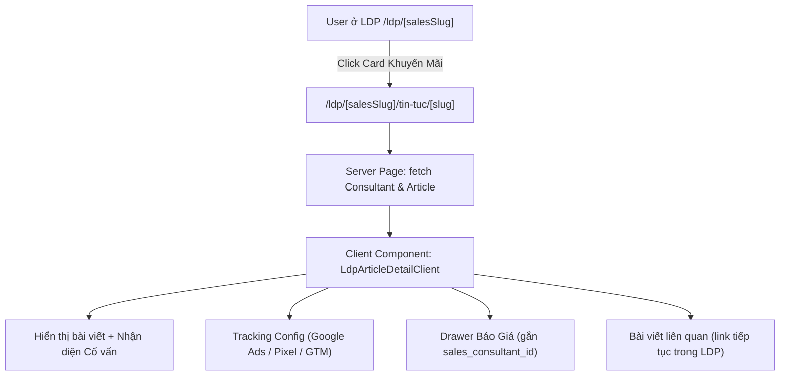

# Plan: LDP Blog & Promotion Detail Page (Trang Chi Tiết Tin Tức / Khuyến Mãi LDP)

> **Mục tiêu:** Khi người dùng xem Landing Page của Cố vấn bán hàng (LDP, ví dụ: `/ldp/bao-ngan`), click vào thẻ khuyến mãi / bài viết thì được chuyển hướng sang trang chi tiết bài viết **nằm trọn trong ngữ cảnh LDP của Cố vấn đó** (`/ldp/[salesSlug]/tin-tuc/[slug]`), giữ nguyên nhận diện thương hiệu, thông tin liên hệ, hotline, form nhận báo giá và mã tracking chuyển đổi của Cố vấn (không bị đẩy về trang tin tức tổng của hệ thống).

---

## 🎯 Bối cảnh & Yêu cầu cốt lõi

1. **Hiện trạng:**
   - Trên LDP (`/ldp/[salesSlug]`), tại khối *"Khuyến Mãi & Quà Tặng Đặc Biệt"*, các card bài viết đang gắn link trực tiếp sang `/tin-tuc/${promo.slug}` (file `fe/src/components/vehicle/LdpHomeClient.tsx:1085`).
   - Khi click vào, người dùng bị chuyển sang trang tin tức tổng công ty (`/tin-tuc/[id]`), mất hoàn toàn context Cố vấn bán hàng, hotline, Zalo và mất lead attribution khi khách điền form.

2. **Yêu cầu mới:**
   - **Đường dẫn chuẩn LDP:** `/ldp/[salesSlug]/tin-tuc/[slug]` (hoặc `/ldp/[salesSlug]/khuyen-mai/[slug]`).
   - **Giữ nguyên nhận diện Cố vấn:**
     - Thanh Cố vấn bán hàng: Avatar, Họ tên, Danh xưng ("Chuyên viên tư vấn"), Hotline, link Zalo.
     - Nút Quay lại: Trở về trang LDP của Cố vấn (`/ldp/[salesSlug]`), không quay về `/tin-tuc`.
   - **Chuyển đổi & Nhận báo giá (Lead Attribution):**
     - Nút/Khối "Nhận báo giá / Đăng ký ưu đãi" tự động gắn `sales_consultant_id` của Cố vấn hiện tại.
     - Sticky CTA Bar (Gọi điện, Chat Zalo, Nhận báo giá) đồng bộ theo Cố vấn.
   - **Đo lường & Tracking Quảng cáo:**
     - Tự động kích hoạt bộ mã theo dõi riêng của Cố vấn (`salesConsultant.tracking_config` qua `ldpTrackingHelpers.ts`): Google Ads Tag, Conversion Labels, GTM, Meta Pixel, TikTok Pixel.
   - **Bài viết liên quan:**
     - Các bài viết liên quan bên dưới tiếp tục giữ đường dẫn trong LDP (`/ldp/[salesSlug]/tin-tuc/[relatedSlug]`).

---

## 🏗️ Kiến trúc & Danh sách tệp cần xử lý



### Các tệp thay đổi / tạo mới:
1. **[Tạo mới]** `fe/src/app/ldp/[salesSlug]/tin-tuc/[slug]/page.tsx`
   - Next.js Server Component: nhận `salesSlug` và `slug` từ `params`.
   - Gọi `ldpAPI.getBySalesSlug(salesSlug)` và `postsAPI.getBySlug(slug)`.
   - Xử lý 404 nếu không tìm thấy Cố vấn hoặc Bài viết.
   - Tạo Metadata SEO & JSON-LD schema `NewsArticle`.
2. **[Tạo mới]** `fe/src/components/vehicle/LdpArticleDetailClient.tsx`
   - Client Component hiển thị chi tiết bài viết với giao diện LDP:
     - Header/Bar thông tin Cố vấn & nút Back về `/ldp/[salesSlug]`.
     - Nội dung bài viết phong phú (tiêu đề, ảnh cover, ngày đăng, nội dung HTML định dạng chuẩn).
     - Khối Call-to-Action (CTA) ưu đãi Cố vấn ở chân bài viết.
     - Drawer Form nhận báo giá tích hợp sẵn `sales_consultant_id`.
     - Kích hoạt tracking scripts của Cố vấn (`injectTrackingTags`).
     - Thanh Bottom Sticky Bar trên mobile (Gọi, Zalo, Báo giá).
3. **[Cập nhật]** `fe/src/components/vehicle/LdpHomeClient.tsx`
   - Sửa hàm `renderPromoClickable` (dòng 1083-1111):
     Thay `href={`/tin-tuc/${promo.slug}`}` bằng:
     ```tsx
     const promoUrl = salesConsultant?.slug 
       ? `/ldp/${salesConsultant.slug}/tin-tuc/${promo.slug}`
       : `/tin-tuc/${promo.slug}`;
     ```
   - Đảm bảo cả ảnh banner và tiêu đề bài viết đều dẫn đến `promoUrl`.

---

## 📋 Danh sách công việc chi tiết (Task Breakdown)

### Task 1: Tạo Server Page `fe/src/app/ldp/[salesSlug]/tin-tuc/[slug]/page.tsx`
- **Mô tả:** Khai báo route động trong App Router, load song song dữ liệu Cố vấn (`ldpAPI`) và dữ liệu bài viết (`postsAPI`).
- **Input:** `salesSlug`, `slug`.
- **Output:** Server page hoàn chỉnh với SSR/ISR, metadata và schema rich snippet.
- **Tiêu chí nghiệm thu:** Truy cập URL `/ldp/bao-ngan/tin-tuc/[slug-bai-viet]` trả về HTTP 200, đúng dữ liệu bài viết và thông tin Cố vấn.

### Task 2: Xây dựng Client Component `fe/src/components/vehicle/LdpArticleDetailClient.tsx`
- **Mô tả:** Thiết kế giao diện chi tiết bài viết mang đậm dấu ấn cá nhân của Cố vấn bán hàng:
  - Thanh trên cùng: Nút quay lại LDP Cố vấn + Avatar & Badge "Chuyên viên tư vấn [Tên]".
  - Nội dung bài viết: Typography chuẩn mực (`prose`), hiển thị hình ảnh tối ưu, ngày đăng, danh mục.
  - Khối CTA cuối bài: Hộp tư vấn ưu đãi đặc quyền với avatar Cố vấn, cam kết hỗ trợ, nút nhận báo giá nhanh.
  - Nút Floating Sticky Bar: Hỗ trợ mobile với 3 nút tác vụ: Gọi điện, Chat Zalo, Nhận báo giá.
- **Tiêu chí nghiệm thu:** Giao diện đẹp, chuẩn responsive cả Desktop và Mobile, nút Back dẫn về đúng trang LDP của Cố vấn.

### Task 3: Tích hợp Form Báo Giá & Tracking Chuyển Đổi Cố Vấn
- **Mô tả:** 
  - Tích hợp `QuoteDrawer` / Form báo giá với `sales_consultant_id` mặc định là ID của Cố vấn.
  - Kích hoạt `injectTrackingTags` từ `ldpTrackingHelpers.ts` khi component mount để các lượt click Hotline, Zalo, Form Submit đều được ghi nhận vào tài khoản Google Ads / Facebook Pixel của Cố vấn đó.
- **Tiêu chí nghiệm thu:** Click "Nhận báo giá" mở modal báo giá với thông tin cố vấn; sự kiện click hotline/Zalo ghi nhận đúng tracking.

### Task 4: Cập nhật đường dẫn điều hướng tại `LdpHomeClient.tsx`
- **Mô tả:** Cập nhật hàm `renderPromoClickable` trong `fe/src/components/vehicle/LdpHomeClient.tsx` để liên kết từ các card khuyến mãi trỏ sang `/ldp/[salesSlug]/tin-tuc/[slug]`.
- **Tiêu chí nghiệm thu:** Trên trang `/ldp/bao-ngan`, click vào ảnh hoặc tiêu đề bài viết (như trong ảnh chụp) chuyển ngay sang `/ldp/bao-ngan/tin-tuc/[slug]` mà không bị tải về `/tin-tuc/[slug]` của hệ thống.

### Task 5: Đồng bộ Bài viết liên quan (Related Articles)
- **Mô tả:** Trong component chi tiết bài viết, các bài viết liên quan (nếu có) cũng được tạo liên kết dạng `/ldp/[salesSlug]/tin-tuc/[slug]`.
- **Tiêu chí nghiệm thu:** Click vào bài viết liên quan vẫn giữ nguyên trong LDP của Cố vấn.

### Task 6: Kiểm thử E2E & Xác thực hoàn tất (Phase X)
- **Mô tả:** Kiểm tra toàn diện luồng:
  1. Vào `http://localhost:3000/ldp/bao-ngan`.
  2. Bấm vào card bài viết khuyến mãi.
  3. Xác nhận URL là `http://localhost:3000/ldp/bao-ngan/tin-tuc/...`.
  4. Xác nhận không có header/footer của trang chính (vẫn là layout LDP).
  5. Bấm Hotline, Chat Zalo, Nhận báo giá hoạt động chính xác với thông tin Cố vấn Bảo Ngân.
  6. Bấm nút Quay lại đưa về `/ldp/bao-ngan`.

---

## 🔒 Câu hỏi Socratic & Quyết định thiết kế (Socratic Decisions)

1. **Về cấu trúc URL:**
   - Quyết định: Sử dụng `/ldp/[salesSlug]/tin-tuc/[slug]` vì nhất quán với URL tin tức của hệ thống (`/tin-tuc/[id]`) và thân thiện với SEO.
2. **Về Form Báo giá trên trang Blog LDP:**
   - Khách đọc bài viết khuyến mãi có thể muốn nhận ưu đãi cho một dòng xe cụ thể hoặc tư vấn chung. Form sẽ cho phép chọn dòng xe quan tâm và tự động gửi lead kèm ID Cố vấn.
3. **Về Layout:**
   - Hệ thống `MainLayoutStructure` đã tự động ẩn Navbar và Footer chính quy đối với mọi route bắt đầu bằng `/ldp/`, do đó giao diện bài viết sẽ hoàn toàn sạch sẽ, không bị lộ menu của hệ thống tổng.

